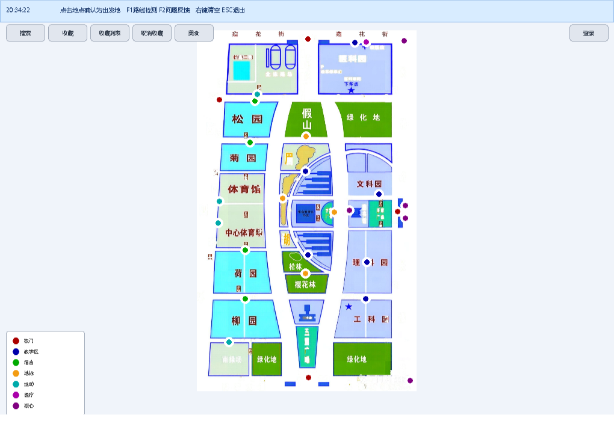
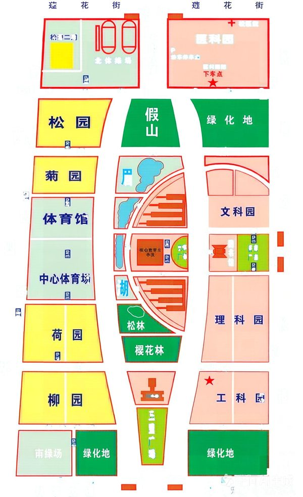

# 校园地图导航系统

> **仓库**：https://github.com/wuhaha-l/campus-nav ｜ **在线展示**：https://wuhaha-l.github.io/campus-nav/ ｜ 展示页源码在 [`docs/`](docs/)

   

基于 **C 语言 + EasyX** 的郑州大学主校区校园导航程序。把 28 个校园地点和道路路口建模成带权无向图，用**按时间加权的 Dijkstra** 规划最快路线，支持步行、骑行、驾车、电动车、地铁 5 种出行方式；点击地图上的地点即可起终点选点、路线高亮、查看距离与预计用时。

> 个人课程设计作品（2026.08），源码约 2100 行，附完整设计报告。适合作为数据结构 / 图算法 / C 语言工程实践的展示项目。

## 界面预览



<details>
<summary>真实地图底图（map.jpg 缩放预览）</summary>



</details>

## 项目亮点

| 方向 | 做法 |
| --- | --- |
| 图建模 | 地点 + 路口共同构成顶点，邻接表存边（距离 / 耗时 / 地铁标记），稀疏图空间 O(n+m) |
| 路径规划 | 时间加权 Dijkstra；状态扩展为 `(来路, 节点)` 并加入 0.5s 转弯罚时，消除等耗时路径在网格路网里的「锯齿绕路」 |
| 真实路网 | 沿道路描点生成折线，端点 8px 吸附到路口，避免路线直穿楼体；地铁口经最近校门接入 5 段地铁线路 |
| 多模式 | 5 种速度模型（步行 5 / 骑车 10 / 驾车 25 / 电动车 25 / 地铁 60 km/h），地铁边仅在地铁可用时松弛 |
| 数据驱动 | 14 个 UTF-8 `.dat` 文件驱动地图、图书、美食与用户数据；换地图只需重新标定坐标 |
| 工程化 | 三层结构（界面交互 / 业务功能 / 数据存储）、临时文件重写防写坏、按学号隔离多用户、宽字符统一处理中文 |
| 验证 | Python 脚本回归 276 对地点两两可达；BFS 检测孤立点与断头路口；VS `/W3` 零警告 |

详细算法推导见 [docs/ALGORITHM.md](docs/ALGORITHM.md)。

## 功能速览

- **路线规划**：两次点击设起终点 → 选出行方式 → 红色高亮路线 + 距离 / 用时 / 预计到达时刻
- **地点搜索**：关键词模糊匹配地点与美食，可设为起点 / 终点 / 探索，支持历史导航地点
- **地点探索**：类型、热度、可直达地点；园区可挑美食，图书馆可进入借阅系统
- **账号体系**：学号注册登录，收藏 / 搜索历史 / 导航历史按学号隔离
- **周边模块**：70 本图书的查询 / 借阅 / 归还 / 分类，49 条园区美食导航
- **地铁出行**：4 个地铁口、5 段线路，校内步行经校门换乘
- **辅助工具**：`F1` 路网质量检测（穿楼 / 断头 / 孤立点）、`F2` 反馈、鼠标拖拽平移、右键清空、`ESC` 退出

完整操作说明见 [docs/USAGE.md](docs/USAGE.md)。

## 快速开始

**方式一：直接运行（Windows）**

双击 `gui.exe`，确保它与所有 `.dat`、`map.jpg` 在同一目录。首次使用相应功能时会自动生成 `users.dat` 等数据文件。

**方式二：从源码编译**

1. Visual Studio（MSVC）+ [EasyX](https://easyx.cn) 图形库
2. 以 **UTF-8（带 BOM）** 编码编译 `gui.cpp`，链接 `EasyXw.lib`（宽字符版）
3. `/W3` 编译，保持零警告

> 源码内中文统一使用宽字符 `L"..."` 与 EasyX 宽字符绘制函数；数据文件为 UTF-8。请勿用 GBK 重新保存，否则中文会乱码。

## 目录结构

```
校园地图导航系统/
├── gui.cpp                        # 全部源码（2100+ 行）
├── gui.exe                        # 已编译可执行文件，可直接运行
├── map.jpg                        # 校园实景地图底图
├── places.dat                     # 28 个地点（编号|名称|类型|热度）
├── coords.dat                     # 地点坐标标定
├── junctions.dat                  # 路口坐标标定
├── place_junctions.dat            # 地点 ↔ 最近路口关联
├── roads.dat                      # 地点直达关系
├── roads_custom.dat               # 道路折线（沿真实道路描点）
├── books.dat                      # 图书数据（70 本）
├── foods.dat                      # 美食数据（49 条）
├── 课程设计报告-校园地图导航.docx  # 完整设计报告：需求、算法、源码清单、测试用例
├── 使用说明.txt                   # 原始使用说明
├── README.md
├── screenshots/
│   ├── main-ui.png                # 主界面运行截图（摘自设计报告）
│   └── campus-map.jpg             # 真实地图底图预览
└── docs/                          # 静态作品展示页（GitHub Pages 发布目录）
    ├── index.html                 # 展示页入口
    ├── styles/  scripts/  assets/
    ├── USAGE.md                   # 操作与数据格式说明
    ├── ALGORITHM.md               # 核心算法与面试讲解要点
    └── DESIGN.md                  # 展示页设计定调与自检
```

> **为什么数据文件放在根目录**：程序按相对路径读取 `.dat` 与 `map.jpg`，必须与 `gui.exe` 同级。移动数据文件会导致功能失效。

## 在线展示

[`docs/`](docs/) 是作品展示页，同时也是 GitHub Pages 的发布目录：技术亮点、可交互的状态扩展 Dijkstra 对照台、界面截图、三层架构，以及可一键复制的简历项目经历文案。

- 线上地址：https://wuhaha-l.github.io/campus-nav/
- Pages 配置为从 `main` 分支的 `/docs` 目录部署，push 后自动更新，不依赖 GitHub Actions。
- 本地预览：直接打开 `docs/index.html`，或在仓库根目录运行 `python3 -m http.server 8080` 后访问 `http://localhost:8080/docs/`。
- 设计定调与自检见 [docs/DESIGN.md](docs/DESIGN.md)。

## 测试与验证

- 路网回归：任意地点对可达（28 个地点共 276 对），5 条地铁边与 4 个地铁口连通性断言
- `F1` 扫描穿楼路段、断头路口、孤立地点
- 边界用例：空搜索词、起终点相同、不存在的地点 / 美食、文件缺失、借期 0~30 天与闰年日期
- 冒烟流程：搜索 → 导航 → 收藏 → 登录 → 图书 → 美食全程可走通

## 截图补充

目前仓库内的 `main-ui.png` 摘自课程设计报告（唯一留存的运行界面截图）。建议再补 3 张，能显著提升简历项目页的可信度：

| 建议文件 | 内容 |
| --- | --- |
| `screenshots/route-result.png` | 选定起终点后红色高亮路线 + 距离 / 用时弹窗 |
| `screenshots/search.png` | 关键词搜索结果列表 |
| `screenshots/library.png` | 图书借阅或美食导航界面 |

用 Snipaste 截取后按上表命名放进 `screenshots/`，再在「界面预览」下按 Markdown 图片语法补一行引用即可。

## 说明

- 本项目为郑州大学「高级语言课程设计」个人作品，完整署名与成绩信息见设计报告；展示页提供报告下载，公开前请确认是否保留署名信息。
- 仅供学习与作品展示，非商业导航产品；地图底图与地点数据为课程设计用途整理。
- `users.dat`、`favorites.dat`、`*_history.dat`、`borrows.dat`、`feedback.txt` 是运行时生成的个人数据（含学号与口令），已在 `.gitignore` 中排除，**请勿提交到公开仓库**。
